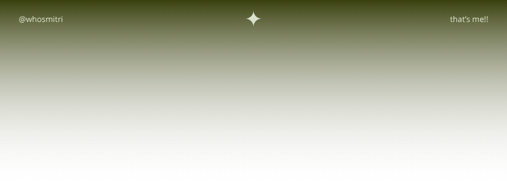

## More Infos !!

<table>
<tr>
<td width="35%" align="center">
<!--  -->

</td>
<td width="65%">

<h3> omg, it's Mitri! </h3>

Hiii, I'm Dmitri, but everyone calls me **Mitri**. I like to explore systems (especially Linux) and document ideas. When I'm not coding, you'll find me studying languages, drawing, or planning my next steps. I believe that life is marked by impermanence, so the important thing is to enjoy each day as if it were a vast, ever-expanding system !!
</td>
</tr>
</table>

---

<table>

<tr>
<td colspan="2" valign="middle">
<h3>Top Projects</h3>
</td>
</tr>

<tr>

<td valign="middle" width="70%">

 
: An IoT ecosystem with AI and an app to help me take care of my lil plants. 

 
: A platform with smart recommendations for learning paths because I’m indecisive, that's it!! 

 
: A simple desktop system for inventory management. 

</td>

<td align="center" valign="middle" width="30%">

</td>
</tr>
</table>

────────────────

⋆˚࿔ ⠀there is no prize to perfection⠀ ₅.₅₃𓍢ִ໋♪ ⠀only an end to pursuit⠀ .✦ ݁˖

────────────────

## Call Me !!

heyy, let's build something together

<!-- linkedin -->  <!-- email -->  <!-- insta --> 

## My Journey

<!-- extended stats -->

<table>
<tr>

<td width="78%" align="center">

<!-- streak -->

</td>

<td width="22%" align="center">

<!-- moon -->

</td>

</tr>
</table>

<!-- activity graph -->

